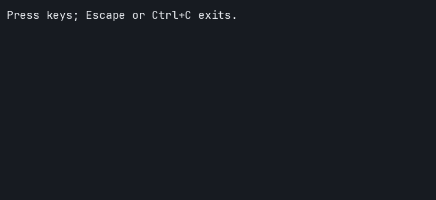
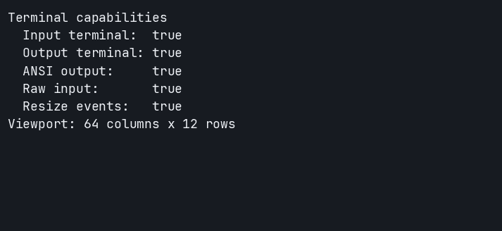
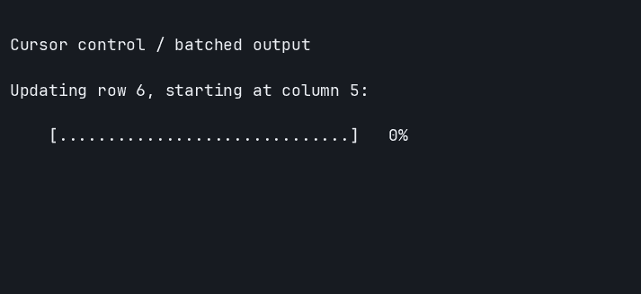
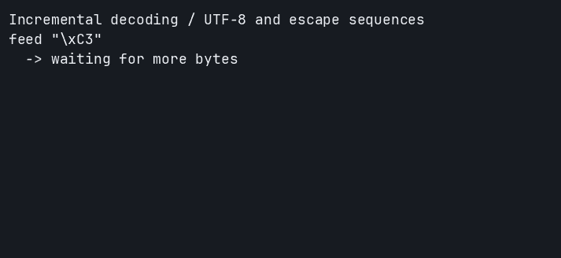
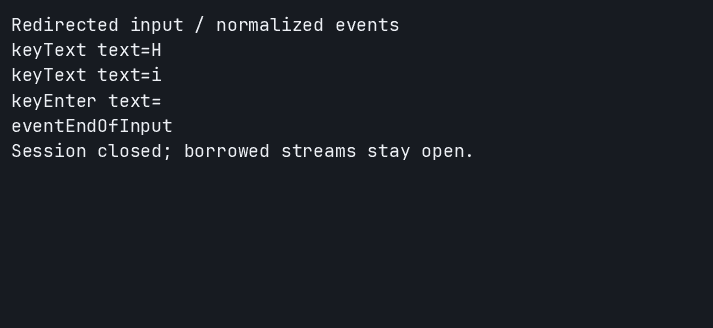

# TerminalScreen

A dependency-free, pure-Nim foundation for interactive terminal applications:
guarded raw-mode sessions, normalized input events, cursor control, capability
detection, geometry, timeouts, and EOF handling. Importing the library does not
change terminal state.

TerminalScreen is the low-level terminal layer for [TerminalPrompt](https://github.com/titanomachy/terminal-prompt) and future interactive packages in [TerminalDeck](https://github.com/titanomachy/terminal-deck). Styling and cell-width-aware
text belong in [TerminalStyle](https://github.com/titanomachy/terminal-style);
layout, prompt policy, and widget state belong in higher-level packages.

## Requirements

- Nim 2.0.0 or newer
- Linux, macOS, or Windows
- A VT/ANSI-capable terminal for cursor commands

Only the Nim standard library and operating-system APIs are required. CI covers
all three platforms with Nim 2.0.x, 2.2.x, and stable.

## Contents

- [TerminalScreen](#terminalscreen)
  - [Requirements](#requirements)
  - [Contents](#contents)
  - [Installation](#installation)
  - [Quick start](#quick-start)
  - [API overview](#api-overview)
    - [Reading keys safely](#reading-keys-safely)
    - [Detection and geometry](#detection-and-geometry)
    - [Cursor control](#cursor-control)
    - [Incremental decoding](#incremental-decoding)
    - [Redirected input and EOF](#redirected-input-and-eof)
  - [Session and cleanup guarantees](#session-and-cleanup-guarantees)
  - [Examples](#examples)
  - [Development and documentation](#development-and-documentation)
  - [License](#license)

## Installation

Install from GitHub with Nimble:

```sh
nimble install https://github.com/titanomachy/terminal-screen
```

Use `import terminal_screen` for the complete public API.

## Quick start

Save this as `main.nim`. It reads one event and restores the terminal before
returning:

```nim
import terminal_screen

withTerminalSession session:
  stdout.write("Press a key.\r\n")
  stdout.flushFile()
  let event = session.readEvent()
  if event.kind == eventKey:
    stdout.write("key: ", $event.keyEvent.key, "\r\n")
    stdout.flushFile()
```

```sh
nim r main.nim
```

Run it in an interactive terminal. For a loop that handles keys, resize events,
and EOF, try `nim r --path:src examples/read_keys.nim` from this repository.

## API overview

| Component | Main API | Purpose |
| --- | --- | --- |
| [Reading keys safely](#reading-keys-safely) | `withTerminalSession`, `readEvent`, `SessionOptions` | Scoped terminal modes, keys, resize events, and timeouts |
| [Detection and geometry](#detection-and-geometry) | `isTerminal`, `detectCapabilities`, `tryTerminalSize` | Choose terminal behavior and query viewport dimensions |
| [Cursor control](#cursor-control) | `moveCursorTo`, `cursorPositionCode`, `cursorUpCode` | One-based cursor movement and batched ANSI commands |
| [Incremental decoding](#incremental-decoding) | `InputDecoder`, `feed`, `nextEvent`, `finish` | Decode fragmented bytes without a live terminal |
| [Redirected input and EOF](#redirected-input-and-eof) | `requireTerminal`, `eventEndOfInput` | Read files and pipes through the same event API |

### Reading keys safely

`withTerminalSession` restores saved terminal modes after normal return or an
exception. Omit options for the defaults, or pass any `SessionOptions` value or
expression. In raw mode, Ctrl+C arrives as `keyCtrlC`, so the application can exit
its loop normally. A lone Escape uses a short configurable timeout.

```nim
import terminal_screen

var options = defaultSessionOptions()
options.hideCursor = true

withTerminalSession session, options:
  while true:
    let event = session.readEvent()
    case event.kind
    of eventKey:
      if event.keyEvent.key in {keyEscape, keyCtrlC}:
        break
      stdout.write($event.keyEvent.key, " ", event.keyEvent.text, "\r\n")
      stdout.flushFile()
    of eventResize:
      discard # Redraw using event.size.columns and event.size.rows.
    of eventEndOfInput:
      break
    of eventTimeout:
      discard
```

[](examples/read_keys.nim)

[Example](examples/read_keys.nim) · [Source recording](docs/recordings/read_keys.cast)

```sh
nim r --path:src examples/read_keys.nim
```

Use `session.readEvent(timeoutMs = 100)` for bounded waits; `eventTimeout` means
no event arrived within that wait. Shorter waits preserve incomplete escape
sequences; `escapeTimeoutMs` measures the gap between sequence bytes across
read calls. The recording scripts text, navigation,
a resize, and Ctrl+C through a private terminal.

### Detection and geometry

Check capabilities before opening an interactive session. `tryTerminalSize`
returns `none` when output has no terminal geometry.

```nim
import std/options
import terminal_screen

let capabilities = detectCapabilities()
echo "Input terminal: ", capabilities.inputIsTerminal
echo "ANSI output: ", capabilities.supportsAnsi

let size = tryTerminalSize()
if size.isSome:
  echo size.get().columns, " columns x ", size.get().rows, " rows"
else:
  echo "Geometry unavailable; use a non-interactive fallback."
```

[](examples/detect_terminal.nim)

[Example](examples/detect_terminal.nim) · [Source recording](docs/recordings/detect_terminal.cast)

```sh
nim r --path:src examples/detect_terminal.nim
```

### Cursor control

Coordinates are one-based. Stream helpers write immediately; pure command
builders let you batch movement and text into one write. A session enables VT
output on supported Windows consoles and restores the previous console mode.

```nim
import terminal_screen

var options = defaultSessionOptions()
options.rawMode = false
options.hideCursor = true
options.monitorResize = false

withTerminalSession session, options:
  moveCursorTo(column = 5, row = 3)
  stdout.write("Working...")
  stdout.write(cursorPositionCode(column = 5, row = 3), "Done.     \r\n")
  stdout.flushFile()
```

[](examples/cursor_commands.nim)

[Example](examples/cursor_commands.nim) · [Source recording](docs/recordings/cursor_commands.cast)

```sh
nim r --path:src examples/cursor_commands.nim
```

The example animates these writes. `stdout.write` adds no newline; end the final
line with `\r\n` to return the shell to the first column of a new line.

### Incremental decoding

`InputDecoder` retains incomplete UTF-8 and escape sequences until more bytes
arrive. It supports text, navigation, common xterm modifiers, unknown sequences,
and a single EOF event after `finish`.

```nim
import std/options
import terminal_screen

var decoder = initInputDecoder()
decoder.feed("\xC3")           # First byte of é: no event yet.
assert decoder.nextEvent().isNone
decoder.feed("\xA9\e[A")      # Completes é, then an Up arrow.

while true:
  let event = decoder.nextEvent()
  if event.isNone:
    break
  echo event.get().keyEvent.key

decoder.finish()
echo decoder.nextEvent().get().kind # eventEndOfInput
```

[](examples/decode_input.nim)

[Example](examples/decode_input.nim) · [Source recording](docs/recordings/decode_input.cast)

```sh
nim r --path:src examples/decode_input.nim --demo
```

### Redirected input and EOF

Strict sessions require terminal streams by default. Set `requireTerminal =
false` for files or pipes; raw mode, cursor hiding, and resize monitoring degrade
according to capabilities. Closing a pipe's writer produces `eventEndOfInput`
after queued bytes are decoded, including on Windows.

```nim
import terminal_screen

var options = defaultSessionOptions()
options.requireTerminal = false

withTerminalSession session, options:
  while true:
    let event = session.readEvent()
    case event.kind
    of eventKey:
      echo event.keyEvent.key, " text=", event.keyEvent.text
    of eventEndOfInput:
      echo "eventEndOfInput"
      break
    of eventResize, eventTimeout:
      discard
```

[](examples/redirected_input.nim)

[Example](examples/redirected_input.nim) · [Source recording](docs/recordings/redirected_input.cast)

```sh
# POSIX shell
printf 'Hi\n' | nim r --path:src examples/redirected_input.nim
```

## Session and cleanup guarantees

- Terminal modes are saved before changes and restored exactly in reverse order.
- Setup is transactional: a later cursor/output failure rolls back an already
  enabled raw input mode. `close` is idempotent.
- Only one session may own process-wide terminal state; nested opens raise
  `SessionActiveError`.
- Sessions borrow their `File` streams; keep them open until cleanup finishes.
- `readEvent` consumes only the bytes needed for one event. Closing and reopening
  over the same input preserves later bytes.
- Resize detection uses bounded geometry polling without allocation or terminal
  cleanup inside signal handlers.

`withTerminalSession` runs cleanup on normal return, decoded Ctrl+C cancellation,
EOF, and Nim exceptions. Uncatchable failures such as `SIGKILL` cannot run
cleanup; Unix `reset` or `tput reset` provides emergency recovery.

## Examples

Every visual above links to its runnable example. Run from the repository root:

| Example | Command |
| --- | --- |
| [Key and resize events](examples/read_keys.nim) | `nim r --path:src examples/read_keys.nim` |
| [Capabilities and geometry](examples/detect_terminal.nim) | `nim r --path:src examples/detect_terminal.nim` |
| [Animated cursor updates](examples/cursor_commands.nim) | `nim r --path:src examples/cursor_commands.nim` |
| [Fragmented input](examples/decode_input.nim) | `nim r --path:src examples/decode_input.nim --demo` |
| [Redirected input](examples/redirected_input.nim) | `printf 'Hi\n' \| nim r --path:src examples/redirected_input.nim` (POSIX shell) |

Compile-check all examples with `nimble examples`.

## Development and documentation

```sh
nimble check
nimble compilePackage
nimble test
nimble examples
nimble docs
nimble releaseCheck
```

Generated compiler output and API documentation stay under `build/`; the API
entry point is `build/docs/terminal_screen.html`. `nimble test` rebuilds the
lifecycle helpers and runs isolated PTY or private Windows Console scenarios
without modifying the developer's terminal.

See [CONTRIBUTING.md](CONTRIBUTING.md) for contribution requirements. To rebuild
the README media on Linux or macOS:

```sh
python3 scripts/regenerate_media.py
```

Recording tools, geometry, font, and rendering details are documented in
[docs/recordings/README.md](docs/recordings/README.md).

## License

TerminalScreen is released under the [MIT License](LICENSE).
